# OpenSite Commerce 可执行自部署系统架构深度研究与工程交付规范

## Executive Summary

OpenSite 当前真正可验证的基线是 V0.7 + PR-01，而非完整已实现的 V0.1–V0.9。方向总体正确，但在继续扩展前必须先跑通 PR-01 的 PostgreSQL 18、RLS、sqlc、pgx 真实验收。V1 应坚持“PostgreSQL 单一事实源、模块化单体、LocalFS 默认、外部能力适配器化”，支付/税务/物流/B2B/多仓进入核心，Marketplace 等按扩展能力递进，Redis、Elastic、K8s、ClickHouse、GraphQL 均不得成为默认依赖。

## 架构基线、缺口与承诺范围

### 当前真正能够作为事实使用的基线

本轮首先需要纠正一个很重要的问题：**目前能够直接审计的工程事实并不是完整的 V0.1–V0.9，而是当前附件中的 V0.7、ORM ADR、PR-01 数据库基础和 PR-01 acceptance-gated 版本。** 因此，V0.1–V0.6、V0.8–V0.9 中没有进入这些工件的内容，只能视为历史设计意图，不能被 Codex/Claude 当作“已经实现”。

当前附件表明：

| 已有能力 | 当前状态 | 本轮结论 |
|---|---|---|
| PostgreSQL schema | migrations `001–009` 已存在 | 保留，继续 forward-only |
| PostgreSQL 版本 | 设计目标 PostgreSQL 18 | 保留；PostgreSQL 官方当前仍将 18 列为支持版本，而 19 处于开发版本线。 |
| 数据访问 | `pgx/v5 + sqlc` | **确定为 V1 标准，不引入核心 ORM** |
| ORM ADR | ADR-070 已接受 | 不重新推翻；至少完成三个真实业务模块后才重新评估 |
| RLS | migrations/policy/harness 已有 | 设计正确，但尚缺真实 PG18 验证 |
| Identity tables | 已有 users/memberships/sessions/API keys | schema ≠ auth runtime；PR-02 仍必须实施 |
| Catalog | Product/SKU/options/listing schema 已有 | 可继续 |
| CMS/Page builder | revisions/drafts/releases 已有 | 可继续 |
| Media | LocalFS + stable `media_asset_id` 方向已有 | 保留，增加 S3 adapter |
| API | 当前约 12 个基础 operation | 远未形成完整 commerce API |
| CI harness | 已增强 | **真实 PG18、sqlc、pgx CI 尚没有最终绿灯证据** |
| Commerce transaction core | carts/orders/payments/tax/shipping/inventory 等基本未实现 | **这是现在最大的架构缺口** |

尤其需要强调：PR-01 acceptance report 当前仍把真实 PostgreSQL 18 DDL/RLS/role audit、sqlc generation、pgx build 等关键门禁标为 BLOCKED/NOT RUN。因此，**下一项工作不应该直接开始 Stripe、Marketplace 或 GraphQL，而应该先把 PR-01 的“设计通过”转化成“真实数据库通过”。**

PostgreSQL RLS 很适合当前多租户纵深防御设计，但官方文档明确指出：table owner 通常可以绕过 RLS，具有 `BYPASSRLS` 的角色也能绕过；开启 RLS 且无匹配 policy 时则是 default-deny。因此 production application role 必须与 migration/owner role 严格分离，并对关键 tenant table 使用 `FORCE ROW LEVEL SECURITY`。

### ORM 的最终决定

**核心继续不用 ORM。**

保持：

```text
PostgreSQL
    ↓
forward-only SQL migrations
    ↓
sqlc
    ↓
pgx/v5
    ↓
domain repository/query
    ↓
domain command/service
```

而不是：

```text
Domain
  ↓
Generic ORM
  ↓
Database abstraction magic
```

原因不是“ORM 不好”，而是 OpenSite 的核心难点正好集中在 ORM 抽象价值最低的部分：

- tenant-local transaction context；
- RLS；
- composite tenant foreign keys；
- explicit row locking；
- inventory reservation concurrency；
- financial ledger；
- forward-only migrations；
- bulk SKU import；
- PostgreSQL-specific features；
- search indexes；
- immutable release；
- idempotency；
- inbox/outbox。

这些需要 SQL 本身成为被审查的一等工程资产。

原 ADR 中提到的 **Bun JavaScript runtime 与 Uptrace Bun Go ORM 是两个完全不同的东西**。前者以后仍可作为前端工具链候选；它不意味着后端必须使用 Bun ORM。

### 现在才暴露出来的关键缺口

16 个用户提出的能力之外，还有几个**必须进入 V1 架构，否则这些能力根本没有稳定落点**的领域。

最重要的是 **Commerce Transaction Core**。目前 Catalog 后面直接跳到 Inquiry/CMS/Publish，中间缺少：

```text
Price List
   ↓
Cart / Quote
   ↓
Order
   ↓
Order Line Snapshot
   ├── Tax Snapshot
   ├── Shipping Quote / Shipment
   ├── Inventory Reservation
   ├── Approval
   └── Payment
```

因此必须新增至少：

```text
price_lists
prices
carts
cart_lines
quotes
quote_lines
orders
order_lines
order_adjustments
order_addresses
```

否则 `payments.order_id`、tax finalization、shipping、B2B approval、inventory reservation 都会成为悬空模块。

第二个缺口是 **Financial Ledger + Reconciliation**。Marketplace、多币种 settlement、退款、平台佣金、卖家 payout 不能靠一张 `settlements` 表或支付网关 webhook 来当账本。Stripe Connect 确实支持平台收款后向 connected accounts 分配资金和 payout；Adyen Marketplace 同样支持 seller onboarding、split 和 payout，但这些都是外部支付基础设施，OpenSite 仍需要自己的预期账、provider reference 和 reconciliation 状态。

第三个缺口是统一的：

```text
idempotency
webhook_inbox
outbox
audit
reconciliation
```

它们不能被 Stripe、Tax、Shipping、Plugin 各自重复造一套。

第四个缺口是完整的运行面：当前 Docker Compose 不能只代表 PostgreSQL，最终最低运行拓扑必须真正覆盖 API、worker、storefront、admin、reverse proxy、PostgreSQL 和 LocalFS。

### V1 的承诺边界

建议正式把产品承诺划为三层：

| 层级 | V1 承诺 |
|---|---|
| **Core / 自带** | Identity、tenant/site、catalog、pricing、cart/order、inquiry、CMS、builder、release、LocalFS、S3 abstraction、B2B、approval、payment terms、支付 adapter、税务规则、物流规则、多仓库存、审计、幂等、outbox/inbox、API Key、视觉 CI、Agent policy |
| **Extension-ready / 接口自带** | Marketplace、multi-currency settlement、Yjs collaboration、custom component SDK、plugin SDK、external search、Valkey cache |
| **Optional / 不得成为基础依赖** | Elasticsearch、Meilisearch、Redis/Valkey、Kubernetes、ClickHouse、GraphQL、public plugin marketplace |

也就是说，**“支持”不等于“默认启动十几个基础设施容器”。**

这恰恰是自部署项目能否真正成功的关键。

工程文档包已整理为可直接进入仓库的结构：

**下载 OpenSite Commerce V1 架构工程文档包（原 ChatGPT 沙箱附件，未交付；见 docs/review/REVIEW.md F-02）**

其中包含 `AGENTS.md`、`CLAUDE.md`、架构说明、ADR、SQL/OpenAPI 示例、前端 CI 示例和首批 Issues CSV。

## 目标系统架构与组件选型

### 总体形态：模块化单体优先，而不是微服务优先

V1 推荐架构仍然是：

> **Modular Monolith + PostgreSQL + Worker + 独立 Web 应用 + Storage Adapter**

而不是立即拆成：

```text
catalog-service
payment-service
tax-service
inventory-service
approval-service
...
```

原因在于订单、库存、审批、B2B credit、ledger 等领域拥有大量需要强事务保证的边界。如果过早服务化，会把本来可以在 PostgreSQL transaction 内解决的问题变成 distributed transaction、event ordering、reconciliation 和 partial failure 问题。

River 很契合这一阶段：官方文档支持 PostgreSQL-backed jobs，并允许 job 与应用数据在**同一个数据库事务里 enqueue**，事务 commit 后 worker 才能看到任务。这恰好适合 OpenSite 的 outbox/async processing 策略；其开源仓库目前声明 MPL-2.0。

目标架构如下：

```mermaid
flowchart TB

    Browser["Browser / API Clients"]

    subgraph Experience["Experience Layer"]
        Storefront["Astro Storefront SSR"]
        Admin["React Admin"]
        Builder["React Page Builder"]
        Storybook["Storybook / Visual CI"]
    end

    Browser --> Storefront
    Browser --> Admin
    Browser --> Builder

    subgraph App["OpenSite Go Modular Monolith"]
        Gateway["HTTP / OpenAPI Gateway"]
        Identity["Identity / Tenant / RBAC"]
        Catalog["Catalog / Pricing"]
        Order["Cart / Quote / Order"]
        B2B["B2B / Inquiry / Approval / Terms"]
        Inventory["Inventory / Warehouse"]
        Commerce["Payments / Tax / Shipping"]
        Finance["Ledger / Settlement"]
        CMS["CMS / PageDocument / Publishing"]
        Media["Media"]
        Extension["Extension / Plugin Gateway"]
        Agent["Agent Policy Gateway"]
        Audit["Audit / Idempotency / Inbox / Outbox"]
    end

    Storefront --> Gateway
    Admin --> Gateway
    Builder --> Gateway

    Gateway --> Identity
    Gateway --> Catalog
    Gateway --> Order
    Gateway --> B2B
    Gateway --> Inventory
    Gateway --> Commerce
    Gateway --> CMS
    Gateway --> Agent

    Commerce --> Finance
    Agent --> CMS
    Agent -. protected commands .-> Order

    subgraph Data["Authoritative Data"]
        PG["PostgreSQL 18"]
        Jobs["River Community"]
    end

    App --> PG
    Jobs --> PG

    subgraph Storage["Blob Storage"]
        LocalFS["LocalFS default"]
        S3["S3 Adapter"]
        RustFS["RustFS"]
        Seaweed["SeaweedFS"]
    end

    Media --> LocalFS
    Media --> S3
    S3 -. optional .-> RustFS
    S3 -. optional .-> Seaweed

    subgraph Optional["Derived / Optional Infrastructure"]
        Valkey["Valkey"]
        Search["Search Adapter"]
        CH["ClickHouse"]
        K8s["Kubernetes"]
    end

    App -. cache .-> Valkey
    App -. index .-> Search
    App -. analytics events .-> CH

    subgraph Providers["External Providers"]
        Stripe["Stripe"]
        Adyen["Adyen"]
        Avalara["Avalara"]
        Carrier["UPS / FedEx / carriers"]
    end

    Commerce --> Stripe
    Commerce --> Adyen
    Commerce --> Avalara
    Commerce --> Carrier
```



对应的 PNG 可作为架构评审附件：

> 图「OpenSite Commerce V1 目标架构」：原 PNG 为 ChatGPT 沙箱产物、未交付，以上方 mermaid 为准。

### 后端模块必须形成真正的 bounded modules

建议 Go repo 最终组织：

```text
/apps
  /api
  /worker

/internal
  /identity
  /tenancy
  /sites

  /catalog
  /pricing

  /cart
  /orders

  /inventory
  /inquiries
  /b2b
  /approvals

  /payments
  /tax
  /shipping

  /ledger
  /marketplace

  /media
  /cms
  /publishing

  /extensions
  /agents

  /audit
  /idempotency
  /events

/platform
  /postgres
  /blobstore
  /queue
  /search
  /cache
  /telemetry

/db
  /migrations
  /queries
```

关键规则是：

> **模块化不能只体现在目录上。**

必须由 CI 阻止：

```text
payments -> SELECT inventory_balances
catalog  -> UPDATE orders
plugin   -> direct SQL
agent    -> direct SQL
```

而允许：

```text
payments -> OrderService.GetPayable()
orders   -> InventoryService.Reserve()
orders   -> TaxService.FinalizeQuote()
```

对于极少数必须跨 domain 保证 hard invariant 的约束，可以有明确 ADR 后建立数据库 FK；但不能随意跨模块共享所有表。

### 前端也必须模块化

推荐：

```text
/apps
  /storefront       Astro
  /admin            React
  /builder          React
  /storybook

/packages
  /ui
  /tokens
  /icons
  /forms
  /commerce-ui
  /builder-ui
  /component-registry
  /api-client
  /i18n
```

**UI primitive 只允许有一个主要来源。**

本轮综合 Base UI、Radix、React Aria 后，我更建议：

> **Admin/Builder 主 primitive = React Aria Components**

而不是 Base UI + Radix 同时作为底层。

React Aria 的官方文档把 accessibility、interaction behavior 和国际化作为核心设计目标；这比“视觉组件多少”更符合一个包含 Builder、Tree、Dialog、Menu、Form、keyboard interaction、国际化后台的 Commerce Admin。

Base UI 本身同样是合理的 headless React 方案，并强调 accessibility/WAI-ARIA；Radix 也拥有成熟的 keyboard/focus/accessibility primitives，因此二者并不是“不好”，而是 **OpenSite 不应该在同一 design-system layer 同时依赖三套 primitive 行为模型**。

建议正式 ADR：

| 方案 | 决策 | 原因 |
|---|---|---|
| React Aria Components | **优先** | Admin/Builder 的 accessibility、i18n、复杂 interaction 更匹配 |
| Base UI | 备选 | headless、较轻，适合组件层较简单时 |
| Radix | 备选/迁移兼容 | 成熟，但不与主 primitive 混用 |
| 三者混用 | **禁止** | focus、state、portal、style adapter、测试行为分裂 |

Storefront 不需要为了统一而把全部 headless UI runtime 带进去：能用 semantic HTML 的位置优先 semantic HTML，design tokens 和 OpenSite 自己的 `@opensite/ui` 才是公共 API。

### 数据、任务与存储选型

| 组件 | 结论 | 许可证/当前状态 | 为什么 |
|---|---|---|---|
| PostgreSQL 18 | **必须** | PostgreSQL License | authoritative transaction store；RLS、FTS、locking、WAL/PITR |
| pgx + sqlc | **必须** | lockfile 管理 | 与现有 ADR 一致，不增加 ORM |
| River Community | **优先** | MPL-2.0 | 与 PG transaction enqueue 契合；核心不得依赖 Pro-only feature。 |
| LocalFS | **默认** | OpenSite 自有实现 | 0 外部对象存储软件成本 |
| RustFS | **首选自部署 S3 升级路径** | Apache-2.0 | S3-compatible、Apache-2.0；官方同时提醒 single-node/single-drive 不能原地扩成 pool，因此迁移设计必须基于 S3 copy，而不是依赖本地磁盘格式。 |
| SeaweedFS | **备选** | Apache-2.0 | S3、scale-out、小对象场景能力丰富；开源仓库声明 Apache-2.0。 |
| Valkey | **可选** | BSD 3-Clause 系 | Redis-compatible cache/ephemeral state 的优先后续选项。 |
| Redis | 不做 mandatory | Redis 8+ 多许可证 | Redis 8 采用 RSALv2/SSPLv1/AGPLv3 许可选择，没必要为了 cache 强制所有 self-host 用户引入它。 |
| ClickHouse | Optional | Apache-2.0 | analytics derived store，不允许成为订单事实源。 |
| Kubernetes | Optional | Apache-2.0 | scale-out deployment profile，不应成为 4 vCPU/8GB 单机门槛。 |

这里最重要的架构决定是：

> **“对象存储免费”应该通过存储抽象实现，而不是通过把某一个开源 S3 server 硬编码成 OpenSite 的依赖实现。**

因此：

```go
type BlobStore interface {
    Put(ctx context.Context, req PutRequest) (BlobRef, error)
    Open(ctx context.Context, ref BlobRef) (io.ReadCloser, error)
    Delete(ctx context.Context, ref BlobRef) error
    Stat(ctx context.Context, ref BlobRef) (BlobInfo, error)
}
```

支持：

```text
LocalFS
S3-compatible
    ├── RustFS
    ├── SeaweedFS
    ├── AWS S3
    └── any compatible provider
```

应用层永远只认：

```text
media_asset_id
media_blob_id
```

不能让页面保存：

```text
/data/uploads/2026/xxx.jpg
```

或直接把 bucket URL 当业务 ID。

### 搜索的正确顺序

PostgreSQL 本身拥有完整 Full Text Search 体系，包括索引、ranking、dictionary 等机制；`pg_trgm` 又可使用 GiST/GIN 加速 similarity 以及 `LIKE`/`ILIKE` 等搜索，因此 Commerce V1 没有理由先增加 Elasticsearch。

| 方案 | V1 | 优点 | 代价/风险 | 触发切换条件 |
|---|---|---|---|---|
| PostgreSQL FTS + `pg_trgm` | **默认** | 0 新服务、一致性简单、备份简单 | 高级搜索能力有限 | 搜索成为独立高负载 workload |
| Meilisearch | Optional adapter | 产品搜索 UX 较容易独立演进 | 新增 index/rebuild/backup 运维；当前仓库包含 MIT 与 BUSL-1.1 不同部分，必须做 feature/license 审核。 | 明确需要独立搜索引擎且许可功能匹配 |
| Elasticsearch | Optional adapter | 适合搜索/分析成为独立平台时 | 新增完整数据复制与运维面；Elastic 当前许可结构包含 ELv2、SSPL 和部分 AGPLv3 选择，发行/嵌入前必须做许可证审查。 | 搜索规模、语言 analyzer、复杂 aggregation 明确超过 PG 方案 |

因此 V1 interface 应先存在：

```go
type CatalogSearch interface {
    SearchProducts(ctx context.Context, q ProductSearchQuery) (ProductSearchResult, error)
}
```

默认：

```text
PostgresCatalogSearch
```

而不是让业务层依赖 Elasticsearch DSL。

## 十六项能力的明确决策

下面是本轮最重要的 16 项正式答案。

| 能力 | 是否自带 | 优先级 | 实现决策 | 核心表 / 接口 | 一致性边界 |
|---|---|---:|---|---|---|
| **支付** | 是 | P1 | Payment domain + provider adapter；Stripe 首实现、Adyen 第二实现 | `payments`, `payment_attempts`, `refunds`, `webhook_inbox` | 本地 state machine authoritative；provider 异步 reconcile |
| **税务** | 是 | P1 | internal rule engine + external adapter | `tax_rules`, `tax_quotes`, `tax_quote_lines`, exemptions | quote immutable；order 保存 final tax snapshot |
| **物流** | 是 | P1 | internal shipping rules + carrier adapters | `shipping_methods`, `shipping_quotes`, `shipments`, `shipment_events` | rate quote 有 expiry；shipment 单独 state machine |
| **B2B 审批流** | 是 | P1 | bounded approval engine，不做通用 BPMN | `approval_policies`, `approval_requests`, `approval_steps`, `approval_actions` | policy version snapshot；action immutable |
| **B2B 付款条款** | 是 | P1 | Net terms / credit account / invoice / receivable | `payment_terms`, `credit_accounts`, `invoices`, `receivables` | credit check/order approval transactionally coordinated |
| **Marketplace** | 核心预留，完整 P2 | P2 | seller/allocation/commission/ledger/payout | `sellers`, `order_allocations`, ledger, `settlements` | internal ledger ≠ provider payout |
| **多币种结算** | 数据模型自带；执行 P2 | P1/P2 | explicit Money + FX quote + ledger | `fx_quotes`, `ledger_entries`, `settlements` | 禁止隐式 FX；每次 conversion 有 provenance |
| **多仓** | 是 | P1 | warehouse + movement ledger + balance + reservation | `warehouses`, `inventory_movements`, `inventory_balances`, `inventory_reservations` | reservation atomic；禁止 oversell |
| **插件市场** | SDK P2，公开市场 P3 | P2/P3 | manifest/capability/signature/compatibility | `extensions`, `extension_installs`, `extension_permissions` | 插件无直接 DB capability |
| **用户自定义组件** | 是，但受控 | P1/P2 | registry + schema；任意 JS sandbox | component manifests / PageDocument | server render 不运行不可信代码 |
| **实时协作编辑器** | Optional | P2 | Yjs 用于 PageDocument draft | collab docs/updates/snapshots | 不进入 payment/inventory/finance |
| **Elasticsearch** | 否，adapter | P3 | PG FTS 默认 | `SearchProvider` | index 为 derived data |
| **Redis** | 否 | P3 | PG/River/in-process first；需要时优先评估 Valkey | `Cache`, rate-limit adapter | cache 永不 authoritative |
| **Kubernetes** | 否 | P3 | Compose reference；K8s scale profile | Helm manifests | 不改变 domain architecture |
| **ClickHouse** | 否 | P3 | analytics/event sink | event stream/read models | eventual consistency only |
| **GraphQL** | 否，optional read facade | P3 | REST/OpenAPI canonical writes | query schema | 初期禁止 GraphQL financial mutations |

### 支付

OpenSite 应该自带的不是“Stripe 业务逻辑”，而是：

```text
Payment domain
  ├── StripePaymentProvider
  ├── AdyenPaymentProvider
  └── FakePaymentProvider
```

Stripe Connect 可以完成 Marketplace 场景中的 connected account、split、transfer 和 payout；Adyen Marketplace 也支持 seller onboarding/verification、split payment 和 payout，因此 provider adapter 抽象具有现实意义。

**绝对不要：**

```go
func CreateOrder(...) {
    stripe.New(...)
}
```

应该：

```go
type PaymentProvider interface {
    CreateIntent(...)
    Capture(...)
    Cancel(...)
    Refund(...)
    GetStatus(...)
}
```

支付外部调用不能包在长数据库事务中：

```text
DB tx
  create payment(created)
  audit
  enqueue provider job
COMMIT

worker
  Stripe.CreateIntent(idempotencyKey)

DB tx
  update provider_ref/state
COMMIT
```

webhook：

```text
verify signature
    ↓
INSERT webhook_inbox
ON CONFLICT(provider,event_id) DO NOTHING
    ↓
commit
    ↓
worker
    ↓
state transition
    ↓
reconciliation
```

### 税务

必须同时提供两层：

```text
Internal Rule Engine
External Tax Provider
```

Stripe Tax 的 Calculation API 可以独立计算税额，Avalara AvaTax 也提供 transaction calculation/recording 类接口，因此 adapter 模式可以让 self-host 用户选择“纯规则模式”或“专业 tax provider 模式”。

但 **OpenSite 不能声称规则引擎自动让商户满足全球税法**。

系统职责是：

```text
jurisdiction inputs
tax category
customer exemption
tax inclusion mode
calculation snapshot
external provider references
audit
```

商户仍需要根据销售地区、注册义务、商品类型等配置税务政策；法律责任不应被软件默认规则掩盖。

### 物流

自带：

```text
ShippingRuleEngine
CarrierAdapter
ShipmentStateMachine
```

例如 UPS 官方提供 Rating API 用于 shipping rate/shop，FedEx 也提供 rate API，因此 adapter 应以统一的 package/address/rate quote contract 封装第三方 carrier。

不要让：

```text
Order -> UPS SDK
```

而是：

```text
Order
  ↓
ShippingService
  ↓
CarrierProvider
```

这样本地固定运费、按重量、按金额免邮、客户自提都不需要第三方 API。

### B2B 审批流

这是 **必须自带** 的 B2B 核心，而不是插件。

但不要建设“低代码 BPMN 平台”。

第一阶段只支持明确的 commerce approval：

```text
amount > 100,000
        ↓
department_manager
        ↓
finance
        ↓
approved
```

以及：

```text
credit_limit exceeded
        ↓
finance approval
```

policy 在 request 创建时 snapshot：

```text
approval_request
  policy_id
  policy_version
```

之后修改 policy 不得改变正在审批的 request。

### B2B payment terms

必须成为独立 domain，而不是 payment provider 的一种状态：

```text
Net 0
Net 15
Net 30
Net 60
Prepaid
Deposit + balance
Manual invoice
```

B2B order 可以：

```text
Order Approved
    ↓
Credit Check
    ↓
Invoice Issued
    ↓
Receivable
    ↓
Payment / Bank Reconciliation
```

它与信用卡 checkout 是完全不同的业务生命周期。

### Marketplace 与多币种 settlement

Marketplace 不能只是给 Product 加：

```sql
seller_id
```

真正模型是：

```text
Order
  ├── Allocation Seller A
  │      ├── gross
  │      ├── tax
  │      ├── platform fee
  │      └── seller net
  │
  └── Allocation Seller B
```

随后：

```text
Payment
   ↓
Ledger Transaction
   ↓
Seller Payable
   ↓
Settlement
   ↓
Provider Payout
   ↓
Reconciliation
```

Stripe 的 separate charges/transfers 以及 Adyen split booking 都进一步说明：**provider payout 和平台自己的 seller ledger 是两个不同问题。** 

Money 模型必须禁止 float：

```go
type Money struct {
    AmountMinor int64
    Currency    CurrencyCode
}
```

FX：

```text
100 USD
×
7.123456 CNY/USD
=
712.35 CNY
```

需要保存：

```text
source_currency
target_currency
source_amount
target_amount
rate
rate_provider
observed_at
rounding_policy
```

不能以后根据“最新汇率”重新解释历史订单。

### Multi-warehouse

多仓必须在 P1 做，而不是以后重构 single-stock 字段。

模型：

```text
SKU
 ├── Warehouse CN-SH
 │     on_hand
 │     reserved
 │     safety_stock
 │
 └── Warehouse US-LA
```

audit source：

```text
inventory_movements
```

performance projection：

```text
inventory_balances
```

temporary commitment：

```text
inventory_reservations
```

最重要的 invariant：

```text
available =
on_hand
- reserved
- safety_stock
```

并发 reserve 必须在一个数据库事务里 lock/validate/update，不允许：

```text
SELECT available
// some time
UPDATE reserved
```

这种 check-then-write race。

PostgreSQL 提供明确的 row/table locking 机制，OpenSite 应当显式使用，而不是把库存并发交给 ORM 隐式行为。

### Plugin、custom components 与 collaboration

**插件市场 ≠ 任意代码执行市场。**

建议三层：

```text
Level A
Declarative integration
webhook / API / config

Level B
UI extension
sandbox iframe

Level C
server executable plugin
out-of-process
```

V1/P2 先做 A+B。

不要一开始允许：

```text
plugin.so
node require(plugin)
dynamic Go plugin
```

直接跑进核心 API 进程。

自定义组件定义：

```json
{
  "type": "vendor.product-spec",
  "version": "1.2.0",
  "propsSchema": {},
  "capabilities": ["catalog:read"]
}
```

不可信 JavaScript：

```text
sandboxed iframe
+
CSP
+
postMessage contract
+
no cookies
+
no database
+
no provider secrets
```

协同编辑推荐 Yjs。其项目定义为 CRDT shared-data framework，能够同步并自动合并并发更新，网络层与数据模型解耦，并且项目声明 MIT license。

但它只能进入：

```text
PageDocument draft
```

不能进入：

```text
inventory_balance
ledger
payment
tax
settlement
```

即：

```text
Yjs collaboration
      ↓
draft PageDocument
      ↓
snapshot
      ↓
Validate
      ↓
immutable page_revision
      ↓
release
```

CRDT document 永远不是 published source of truth。

### Redis、Kubernetes、ClickHouse、GraphQL

**Redis：现在不需要。**

目前已有 PostgreSQL + River 足以覆盖：

```text
jobs
idempotency
outbox
sessions
locks
scheduled work
```

cache 使用：

```text
bounded in-process cache
```

真正出现以下指标以后再引入外部 cache：

```text
DB hot-read pressure
shared rate limiter requirement
ephemeral high-frequency counters
cross-instance invalidation
```

届时优先评估 Valkey，而不是把 Redis 设成 OpenSite 安装前提。Redis 8 当前采用多许可证方案，而 Valkey 保持 BSD 系开源定位。

**Kubernetes：支持，但绝不能是 V1 正常用户的必选部署方式。**

正确关系是：

```text
Domain Architecture
        ↓
container images
        ├── Docker Compose
        └── Kubernetes
```

而不是两个版本的应用架构。Kubernetes 本身是 Apache-2.0 项目，但引入 Kubernetes 不会消除 PostgreSQL、storage、backup、secret、network-policy 等运维问题，只会改变它们的部署方式。

**ClickHouse：只做 analytics。**

```text
orders
payments
page views
inquiries
    ↓
outbox / event export
    ↓
ClickHouse
```

绝不能：

```text
Checkout -> ClickHouse -> decide inventory
```

ClickHouse 可以被删除并全量重建，而订单依然必须正确；这就是 derived store 的标准。

**GraphQL：暂缓 public write API。**

GraphQL 的 typed schema/query 模型本身适合复杂 frontend aggregation，但 OpenSite 目前已经有 OpenAPI 方向，没有必要在核心 transaction API 尚未稳定前维护 REST + GraphQL 两套 mutation contract。GraphQL 的正式规范定义了 schema/type/query execution contract，因此它以后完全可以作为一个独立 read facade，而不是侵入 domain service。

建议：

```text
P1/P2
REST/OpenAPI:
  Reads + Writes

P3
GraphQL:
  Reads first

Protected mutations:
  still domain REST commands
```

## 数据模型、事务边界与 API 契约

### SQL 基准

以下是架构级示例；真正进入仓库时必须按现有 checksum-protected migration 规则形成新的 migration，不得修改历史 migrations。

```sql
CREATE TABLE warehouses (
    id uuid PRIMARY KEY DEFAULT uuidv7(),
    tenant_id uuid NOT NULL,
    code text NOT NULL,
    name text NOT NULL,
    country_code char(2),
    address jsonb NOT NULL DEFAULT '{}'::jsonb,
    active boolean NOT NULL DEFAULT true,
    created_at timestamptz NOT NULL DEFAULT now(),

    UNIQUE (tenant_id, code),
    UNIQUE (tenant_id, id)
);

CREATE TABLE payments (
    id uuid PRIMARY KEY DEFAULT uuidv7(),
    tenant_id uuid NOT NULL,
    order_id uuid NOT NULL,

    provider text NOT NULL,
    provider_payment_id text,

    status text NOT NULL CHECK (
      status IN (
        'created',
        'requires_action',
        'authorized',
        'captured',
        'failed',
        'cancelled',
        'partially_refunded',
        'refunded'
      )
    ),

    amount_minor bigint NOT NULL CHECK (amount_minor >= 0),
    captured_minor bigint NOT NULL DEFAULT 0 CHECK (captured_minor >= 0),
    refunded_minor bigint NOT NULL DEFAULT 0 CHECK (refunded_minor >= 0),

    currency_code char(3) NOT NULL,

    idempotency_key text NOT NULL,

    created_at timestamptz NOT NULL DEFAULT now(),
    updated_at timestamptz NOT NULL DEFAULT now(),

    UNIQUE (tenant_id, idempotency_key),
    UNIQUE NULLS NOT DISTINCT (
      tenant_id,
      provider,
      provider_payment_id
    ),

    UNIQUE (tenant_id, id)
);

CREATE TABLE tax_rules (
    id uuid PRIMARY KEY DEFAULT uuidv7(),
    tenant_id uuid NOT NULL,

    version integer NOT NULL,

    country_code char(2) NOT NULL,
    region text,
    postal_pattern text,
    tax_code text,

    rate numeric(12,8) NOT NULL CHECK (rate >= 0),
    priority integer NOT NULL DEFAULT 100,

    valid_from timestamptz NOT NULL,
    valid_to timestamptz,

    enabled boolean NOT NULL DEFAULT true,
    created_at timestamptz NOT NULL DEFAULT now(),

    UNIQUE (tenant_id, id)
);

CREATE TABLE shipments (
    id uuid PRIMARY KEY DEFAULT uuidv7(),
    tenant_id uuid NOT NULL,

    order_id uuid NOT NULL,
    warehouse_id uuid NOT NULL,

    carrier text,
    service_code text,
    tracking_number text,

    status text NOT NULL CHECK (
      status IN (
        'pending',
        'ready',
        'shipped',
        'delivered',
        'exception',
        'cancelled'
      )
    ),

    shipped_at timestamptz,
    delivered_at timestamptz,
    created_at timestamptz NOT NULL DEFAULT now(),

    UNIQUE (tenant_id, id),

    FOREIGN KEY (tenant_id, warehouse_id)
      REFERENCES warehouses(tenant_id, id)
);

CREATE TABLE approval_requests (
    id uuid PRIMARY KEY DEFAULT uuidv7(),
    tenant_id uuid NOT NULL,

    subject_type text NOT NULL,
    subject_id uuid NOT NULL,

    policy_id uuid NOT NULL,
    policy_version integer NOT NULL,

    state text NOT NULL CHECK (
      state IN (
        'pending',
        'approved',
        'rejected',
        'changes_requested',
        'cancelled'
      )
    ),

    requested_by uuid NOT NULL,
    current_step integer NOT NULL DEFAULT 1,

    requested_at timestamptz NOT NULL DEFAULT now(),
    decided_at timestamptz,

    UNIQUE (tenant_id, id)
);

CREATE TABLE settlements (
    id uuid PRIMARY KEY DEFAULT uuidv7(),
    tenant_id uuid NOT NULL,

    seller_id uuid NOT NULL,

    provider text,
    provider_payout_id text,

    currency_code char(3) NOT NULL,

    gross_minor bigint NOT NULL,
    fee_minor bigint NOT NULL DEFAULT 0,
    adjustment_minor bigint NOT NULL DEFAULT 0,
    net_minor bigint NOT NULL,

    state text NOT NULL CHECK (
      state IN (
        'open',
        'scheduled',
        'submitted',
        'paid',
        'failed',
        'reconciled'
      )
    ),

    period_start timestamptz NOT NULL,
    period_end timestamptz NOT NULL,
    created_at timestamptz NOT NULL DEFAULT now(),

    UNIQUE (tenant_id, id)
);

CREATE TABLE inventory_balances (
    tenant_id uuid NOT NULL,
    warehouse_id uuid NOT NULL,
    variant_id uuid NOT NULL,

    on_hand bigint NOT NULL DEFAULT 0,
    reserved bigint NOT NULL DEFAULT 0
      CHECK (reserved >= 0),

    safety_stock bigint NOT NULL DEFAULT 0
      CHECK (safety_stock >= 0),

    version bigint NOT NULL DEFAULT 0,

    PRIMARY KEY (
      tenant_id,
      warehouse_id,
      variant_id
    ),

    FOREIGN KEY (tenant_id, warehouse_id)
      REFERENCES warehouses(tenant_id, id)
);
```

这还不够。Marketplace 正式进入实施阶段时应增加：

```text
ledger_accounts
ledger_transactions
ledger_entries
reconciliation_runs
reconciliation_items
```

并建立：

```sql
SUM(debit) = SUM(credit)
```

这一类不可破坏的 ledger invariant。

### RLS 标准模板

```sql
ALTER TABLE payments ENABLE ROW LEVEL SECURITY;
ALTER TABLE payments FORCE ROW LEVEL SECURITY;

CREATE POLICY payments_tenant_policy
ON payments
USING (
  tenant_id =
  current_setting('app.tenant_id', true)::uuid
)
WITH CHECK (
  tenant_id =
  current_setting('app.tenant_id', true)::uuid
);
```

Application request：

```sql
BEGIN;

SET LOCAL app.tenant_id =
  '018f...';

-- sqlc queries

COMMIT;
```

同时要求：

```text
app_runtime:
    NO BYPASSRLS
    NOT table owner

migration_role:
    owns schema / migrations
    never used by HTTP API
```

因为 PostgreSQL 官方明确说明 owner 与 `BYPASSRLS` role 的绕过行为。

### OpenAPI 示例

Canonical write contract 继续用 OpenAPI。

```yaml
openapi: 3.1.0

paths:

  /api/v1/orders/{order_id}/payment-intents:
    post:
      operationId: createPaymentIntent

      parameters:
        - in: header
          name: Idempotency-Key
          required: true
          schema:
            type: string

      requestBody:
        required: true
        content:
          application/json:
            schema:
              type: object
              required:
                - provider
              properties:
                provider:
                  type: string
                  enum:
                    - stripe
                    - adyen

      responses:
        "201":
          description: Payment created
        "200":
          description: Idempotent replay
        "409":
          description: Order is not payable
```

税务：

```yaml
/api/v1/tax/quotes:
  post:
    operationId: calculateTaxQuote

    requestBody:
      required: true
      content:
        application/json:
          schema:
            type: object
            required:
              - currency
              - ship_to
              - lines

            properties:

              currency:
                type: string
                minLength: 3
                maxLength: 3

              ship_to:
                $ref: "#/components/schemas/Address"

              customer_tax_profile_id:
                type: string
                format: uuid

              lines:
                type: array
                minItems: 1
                items:
                  $ref: "#/components/schemas/TaxQuoteLine"

    responses:
      "200":
        description: Immutable tax quote
```

物流：

```yaml
/api/v1/shipping/quotes:
  post:
    operationId: quoteShipping

    requestBody:
      required: true
      content:
        application/json:
          schema:
            type: object

            required:
              - destination
              - lines

            properties:

              destination:
                $ref: "#/components/schemas/Address"

              warehouse_strategy:
                type: string
                enum:
                  - cheapest
                  - nearest
                  - preferred
                  - explicit

              lines:
                type: array
                items:
                  type: object
                  required:
                    - variant_id
                    - quantity

    responses:
      "200":
        description: Eligible shipping quotes with expiry
```

B2B approval：

```yaml
/api/v1/approval-requests/{approval_id}/actions:
  post:
    operationId: actOnApproval

    parameters:
      - in: header
        name: Idempotency-Key
        required: true
        schema:
          type: string

    requestBody:
      required: true
      content:
        application/json:
          schema:
            type: object

            required:
              - action

            properties:

              action:
                type: string
                enum:
                  - approve
                  - reject
                  - request_changes

              comment:
                type: string
                maxLength: 4000

    responses:
      "200":
        description: Approval state transitioned

      "409":
        description: Action invalid for current step
```

Inquiry 保持原有公共边界：

```yaml
/api/public/v1/inquiries:
  post:
    operationId: submitInquiry

    responses:
      "202":
        description: Inquiry accepted
```

multi-warehouse reservation：

```yaml
/api/v1/inventory/reservations:
  post:
    operationId: reserveInventory

    parameters:
      - in: header
        name: Idempotency-Key
        required: true
        schema:
          type: string

    requestBody:
      required: true
      content:
        application/json:
          schema:
            type: object

            required:
              - reference_type
              - reference_id
              - lines

            properties:

              reference_type:
                type: string
                enum:
                  - cart
                  - quote
                  - order

              reference_id:
                type: string
                format: uuid

              expires_at:
                type: string
                format: date-time

              lines:
                type: array
                items:
                  type: object

                  required:
                    - variant_id
                    - quantity

                  properties:

                    variant_id:
                      type: string
                      format: uuid

                    warehouse_id:
                      type: string
                      format: uuid

                    quantity:
                      type: integer
                      minimum: 1

    responses:
      "201":
        description: Reservation created

      "409":
        description: Insufficient inventory
```

### 强一致、最终一致必须被明确区分

推荐用下面这张表作为所有模块 PR 模板的一部分：

| 操作 | 一致性 |
|---|---|
| order line + price snapshot | Strong |
| inventory reserve | Strong |
| approval transition | Strong |
| credit-limit consumption | Strong |
| ledger entries | Strong |
| release pointer switch | Strong |
| provider payment response | External / reconciled |
| carrier tracking | Eventual |
| tax provider reconciliation | Eventual |
| search index | Eventual |
| ClickHouse analytics | Eventual |
| email | Eventual |
| webhook delivery | Eventual |
| cache | Disposable |

支付/税务/物流最容易犯的错误是把网络 RPC 放在 DB transaction 里面：

```text
BEGIN
UPDATE order
call Stripe for 4 seconds
COMMIT
```

禁止这样做。

正确方案：

```text
local intent
    ↓
commit
    ↓
external side effect
    ↓
webhook/poll
    ↓
reconcile
```

Stripe 和 Adyen 都以 asynchronous webhook/event 作为支付生命周期的重要组成部分，因此 OpenSite 必须把 duplicate、out-of-order 和 reconciliation 当作正常系统状态，而不能假定一次 HTTP response 就代表最终财务事实。

## 工程交付、前端质量、安全与 Agent 门禁

### 前端 CI 必须成为 merge gate，而不是报告工具

建议 CI pipeline 固化为：

```text
lint
 ↓
typecheck
 ↓
unit
 ↓
Storybook build
 ↓
axe
 ↓
Playwright interaction
 ↓
Playwright screenshot
 ↓
bundle budget
 ↓
API contract
 ↓
real PG integration
 ↓
security
 ↓
release
```

Storybook 官方 accessibility addon 基于 axe-core，并支持将 accessibility check 集成进入测试流程；Playwright 原生提供 `toHaveScreenshot()` visual comparison，同时官方明确提醒 screenshot baseline 必须在一致运行环境中生成。

Playwright 也支持配合 `@axe-core/playwright` 做 automated accessibility test，但其官方文档明确指出自动化 accessibility scan 并不能发现所有问题，因此 release-critical UI 仍需 keyboard/screen-reader/manual review。

目标标准采用 WCAG 2.2 AA。W3C 已正式发布 WCAG 2.2，并提供 WAI-ARIA 对 dynamic content 和 advanced UI controls 的辅助可访问性规范。

Story：

```tsx
import type { Meta, StoryObj } from "@storybook/react";
import { ApprovalCard } from "./ApprovalCard";

const meta = {
  component: ApprovalCard,
  args: {
    title: "采购订单 PO-10042",
    amount: "¥128,400.00",
    state: "pending"
  }
} satisfies Meta<typeof ApprovalCard>;

export default meta;

type Story = StoryObj<typeof meta>;

export const Pending: Story = {};

export const LongContent: Story = {
  args: {
    title:
      "用于验证超长企业采购审批标题、换行和焦点顺序的示例"
  }
};
```

Playwright：

```ts
import { test, expect } from "@playwright/test";
import AxeBuilder from "@axe-core/playwright";

test(
  "approval page visual + accessibility",
  async ({ page }) => {
    await page.goto(
      "/admin/approvals/demo"
    );

    await expect(page).toHaveScreenshot(
      "approval-demo.png",
      {
        animations: "disabled"
      }
    );

    const results =
      await new AxeBuilder({ page })
        .withTags([
          "wcag2a",
          "wcag2aa",
          "wcag21aa",
          "wcag22aa"
        ])
        .analyze();

    const severe =
      results.violations.filter(
        v =>
          v.impact === "critical" ||
          v.impact === "serious"
      );

    expect(severe).toEqual([]);
  }
);
```

**Screenshot baseline 绝不能由 bot 自动接受。**

流程：

```text
UI PR
 ↓
CI detects visual diff
 ↓
artifact attached
 ↓
designer / authorized reviewer
 ↓
visual-approved
 ↓
new baseline enters repository
```

也就是说：

```text
UPDATE_SNAPSHOTS=1
```

不允许作为 CI 自动 fallback。

### CI 不允许“因为没改这个目录所以跳过安全检查”

这是此前架构中非常值得补的一点。

Required Checks 应设计为：

```text
always starts
    ↓
determines impacted modules
    ↓
either:
 PASS - tested
or
 PASS - explicitly not applicable
```

而不是 workflow 根本没有运行。

核心 mandatory gates：

```text
migration integrity
RLS isolation
auth
OpenAPI
sqlc generation
Go race/vet/test
frontend typecheck
visual/a11y
SBOM/license
dependency vulnerabilities
secret scan
container scan
```

都必须有可观察结果。

### 支付和 PCI 边界

PCI SSC 负责维护用于保护 payment account data 的 PCI standards；因此 OpenSite 的架构目标应是**最大限度避免自己接触 payment card data**，而不是尝试成为一个自建 card vault。

推荐：

```text
Browser
  ↓
Stripe / Adyen hosted or tokenized payment UI
  ↓
provider token / intent reference
  ↓
OpenSite
```

OpenSite 持久化：

```text
provider
provider_customer_ref
payment_intent_ref
payment_method_ref
status
amount
currency
last4/display metadata if provider allows
```

不得持久化：

```text
full PAN
CVV/CVC
raw magnetic/chip data
```

并且不能在文档里声称“用了 Stripe 就自动满足某一种 SAQ”。实际 PCI scope 取决于 checkout integration、页面控制方式、merchant/acquirer 关系和部署方式，必须由相应合规流程确认。

### SSRF 是 OpenSite 特别需要防的攻击面

OpenSite 会天然拥有很多 URL input：

```text
remote image import
webhook endpoint
plugin endpoint
external feed
carrier callbacks
custom component resources
```

OWASP 把“应用按照用户提供的 URL 去请求内部或外部资源”明确列为 SSRF 风险，并建议优先采用 allowlist、防止 unsafe redirect、校验解析后的目标 IP，以及同时使用 application/network layer 防护。

OpenSite 必须统一实现：

```text
OutboundHTTPClient
```

禁止各模块：

```go
http.Get(userURL)
```

策略至少包括：

```text
http/https only
no file://
no gopher://
no unix socket
no localhost
no link-local
no RFC1918 unless explicit allowlist
no cloud metadata endpoint
DNS resolution validation
redirect revalidation
max redirects
response size cap
timeout
content-type check
egress network policy
```

尤其要防：

```text
public.example
   DNS first resolves public
   ↓
redirect / DNS rebinding
   ↓
127.0.0.1
```

OWASP 也特别指出单纯域名 allowlist 并不能自动解决 DNS rebinding，应对最终连接 IP 做校验。

### API Key 与权限模型

建议最终授权：

```text
effective_permissions =
    RolePermissions
    ∩
    ApiKeyScopes
    ∩
    ResourcePolicy
```

而不是 union。

API Key：

```text
osk_live_abc123_XXXXXXXXXXXXXXXX
         ↑
       prefix
```

数据库只保存：

```text
key_prefix
key_hash
actor_id
tenant_id
scopes
expires_at
last_used_at
revoked_at
```

完整 key 只显示一次。

角色建议：

```text
owner
admin
developer
catalog_manager
content_editor
sales
finance
fulfillment
viewer
```

另外不要试图只靠 RBAC 解决所有审批场景：

```text
finance
```

表示“有能力执行财务行为”；

而：

```text
approval request step 2
```

表示“这一笔业务当前允许哪个 finance user 执行什么行为”。

两者不是同一个模型。

### Agent/AI 的硬安全边界

正式把 Agent workflow 固化为：

```text
SiteSpec
   ↓
Plan
   ↓
Validate
   ↓
Apply
   ↓
Publish
```

**SiteSpec**

只表达用户意图：

```json
{
  "goal": "创建工业设备产品页",
  "locale": "zh-CN"
}
```

不具有权限。

**Plan**

Agent 可以形成：

```text
create page
reuse component
bind catalog field
generate draft copy
```

仍然没有 write effect。

**Validate**

必须由 deterministic validator 验证：

```text
schema
permissions
component existence
references
URLs
protected data
publish policy
claims
financial effects
```

**Apply**

只能默认进入：

```text
draft
```

不得直接：

```text
captured payment
inventory movement
tax finalization
settlement
credit-limit change
published release
```

**Publish**

是独立 privileged command。

建议定义 Agent 权限等级：

| 等级 | Agent 行为 |
|---|---|
| A0 | read/search |
| A1 | create draft |
| A2 | reversible content operations |
| A3 | inventory/payment/tax/finance/approval/publish |
| A4 | security/role/API-key/system config |

默认：

```text
Agent autonomous <= A2
```

A3：

```text
Agent proposes DomainCommand
       ↓
deterministic validation
       ↓
policy/human approval
       ↓
domain service executes
```

A4 默认禁止 autonomous execution。

因此 Agent **永远不应该拿到数据库写权限**。

也不应该：

```text
AI → Stripe SDK
AI → inventory UPDATE
AI → tax finalization
```

而必须：

```text
AI
 ↓
typed command proposal
 ↓
policy gateway
 ↓
domain command
 ↓
audit/idempotency
 ↓
execution
```

这使 Agent 即使出现 hallucination，也没有能力直接破坏账本。

## 部署、迁移、可观测性与风险控制

### 单机 4 vCPU / 8GB 的标准部署

**不要在最低配置中启动 Elasticsearch + Redis + ClickHouse + RustFS + Kubernetes。**

Reference Compose：

```text
Caddy
  |
  +-- opensite-api
  |
  +-- opensite-storefront
  |
  +-- opensite-admin
  |
  +-- opensite-worker
  |
  +-- PostgreSQL 18
  |
  +-- LocalFS volume
```

建议初始内存 envelope，仅作为部署预算而不是性能承诺：

| Component | 初始预算 |
|---|---:|
| PostgreSQL | 2.5–3 GB |
| API + worker | 1–1.5 GB |
| Astro/Admin runtime | 1–1.5 GB |
| Reverse proxy | <0.25 GB |
| OS / filesystem cache / safety | 约 2 GB |

因此默认环境不能同时承诺：

```text
Elastic
ClickHouse
Redis
distributed object storage
```

有真实 workload 后，再拆：

```text
Node A
API / Web

Node B
PostgreSQL

Node C
worker

Node D...
object storage
```

再进一步：

```text
Kubernetes
```

### LocalFS → S3-compatible 的正确迁移

迁移绝不能改变：

```text
media_asset_id
```

建议：

```text
Phase A
启用 S3 backend
新上传直接进入 S3

Phase B
read:
  S3 first
  LocalFS fallback

Phase C
background copy
LocalFS blob
  ↓
S3
  ↓
checksum verify
  ↓
transactionally update blob storage locator

Phase D
100% verify

Phase E
disable LocalFS fallback

Phase F
retention period

Phase G
delete old files
```

即：

```text
Asset identity
     !=
Storage location
```

RustFS 当前官方仓库声明 S3-compatible 和 Apache-2.0，并明确指出 single-node/single-drive deployment 不能直接原地扩成 pool，而应该通过 S3 migration 转向新 topology，这反而进一步支持 OpenSite 使用 storage-protocol migration，而不是绑定内部磁盘布局。

SeaweedFS 开源版本同样是 Apache-2.0，并提供 S3 endpoint、单 binary 起步以及 scale-out 路径，因此它是 RustFS 之外值得保留的 adapter-level 选择。

结论：

> **OpenSite 本身永远不强迫用户购买对象存储。LocalFS 是默认；RustFS/SeaweedFS 是免费软件层的 scale-out 选项；云 S3 是用户自行选择的商业选项。**

但“软件免费”不意味着磁盘、备份、电力、带宽和运维免费，这一点必须在部署文档中明确。

### PostgreSQL 备份不是 `pg_dump` cron 就结束

最低生产策略：

```text
nightly logical backup
+
base backup
+
WAL archive
+
off-host copy
+
restore drill
```

PostgreSQL 官方文档说明，base backup + continuous WAL archive 能实现 point-in-time recovery，而 `pg_dump` 本身不是 WAL continuous-archiving backup 的替代。

建议定义但**暂不对外承诺**：

```text
Target RPO: <= 5 minutes
Target RTO: <= 60 minutes
```

只有在真实 restore drill 达标后才能把：

```text
target
```

变成：

```text
SLO
```

CI/运营应有：

```text
backup-created
restore-tested
schema-version-verified
media-checksum-sampled
```

证据。

媒体必须独立备份，因为恢复 PostgreSQL 不能自动恢复 LocalFS/S3 blob。

### Search、analytics、cache 的“可删除性测试”

这是非常值得新增的 architecture test：

```text
Delete Valkey
→ business correctness unchanged

Delete search index
→ rebuild from PostgreSQL

Delete ClickHouse
→ rebuild analytics from exported events where retained

Delete collaboration cache
→ immutable revisions unaffected
```

如果删掉一个 derived service 会导致订单消失，就说明系统边界设计错了。

### 供应链与 release

每次正式 release 应至少产出：

```text
source commit
container digest
SBOM
dependency inventory
license inventory
vulnerability report
migration manifest
OpenAPI checksum
frontend artifact checksum
signature
```

第三方依赖的许可证不能只在 ADR 写一次。

CI 必须针对 lockfile 实际版本重新产生 license inventory，因为本轮研究已经看到几个典型例子：

- Elasticsearch 的许可历史和当前许可结构较复杂；
- Redis 8 的许可模型发生变化；
- Meilisearch 仓库存在 MIT + BUSL-1.1 范围差异；
- RustFS 和 SeaweedFS 当前分别声明 Apache-2.0；
- River 当前声明 MPL-2.0；
- Yjs 当前声明 MIT。

所以 license review 是持续 CI，而不是一次性文档工作。

### 风险排序

| 风险 | 等级 | 后果 | 缓解 |
|---|---|---|---|
| PR-01 从未在真实 PG18 通过 | **Critical** | 所有后续数据设计建立在未验证基础上 | PR-01A 阻断后续 schema PR |
| 缺少 Cart/Order 核心 | **Critical** | payment/tax/shipping 无正确 aggregate | PR-04 先实施 |
| RLS app role 误用 owner/BYPASSRLS | **Critical** | 跨租户数据泄露 | role separation + FORCE RLS + CI |
| Inventory race/oversell | **Critical** | 销售错误 | row locking + reservation invariant |
| Payment webhook duplicate/out-of-order | **Critical** | 重复记账/错误状态 | inbox + unique event + reconcile |
| Marketplace 无 ledger | **Critical** | seller balance 无法审计 | double-entry ledger |
| Agent 能直接修改 protected domain | **Critical** | 财务/库存破坏 | policy gateway + A3 approval |
| 任意 URL fetch | **High** | SSRF/internal network exposure | centralized outbound client |
| Plugin 进核心进程 | **High** | RCE/tenant isolation failure | capability + out-of-process |
| Tax rule 被宣传为自动合规 | **High** | 法务/税务风险 | rule provenance + external adapter + disclaimer |
| Visual CI 可自动接受 baseline | **High** | UI regression 被隐藏 | human baseline approval |
| Search/cache 变 authoritative | **High** | 数据丢失/一致性错误 | derived-state contract |
| LocalFS 无 off-host backup | **High** | 媒体永久丢失 | independent media backup |
| 同时部署过多基础设施 | **High** | 4vCPU/8GB 无法现实运行 | optional profiles |
| Plugin/API contract 无版本化 | Medium | 升级破坏生态 | capability + semver compatibility |
| 多币种使用 float | **High** | 财务误差 | bigint minor units + explicit FX |
| 发布直接修改 live page | **High** | 无恢复能力 | immutable release |
| GraphQL/REST 双写 contract 过早 | Medium | API 漂移 | REST canonical |
| 未做真实 restore drill | **High** | “有备份但恢复不了” | scheduled restore test |
| UI primitive 多套混用 | Medium | accessibility/focus 行为不一致 | 单 primitive policy |

## 可直接交付 Codex、Claude 与开发团队的实施路线

### 首批二十个 Issue / PR

这 20 个任务应按依赖执行，而不是 20 个团队同时开工。

| Issue/PR | 模块 | 内容 | 依赖 | 验收 |
|---|---|---|---|---|
| **PR-01A Execute PostgreSQL 18 acceptance gates** | Database | 真实 PG18 跑 migrations、role、RLS、tenant isolation、release integrity | 无 | 全部门禁 green；保存日志 |
| **PR-01B Pin toolchain and remove offline-version drift** | Build | 锁定 Go/sqlc/pgx/CI image | PR-01A | clean checkout 可重现 generate/test |
| **PR-02 Authentication and tenant context** | Identity | session、API Key、tenant resolution、tx-local tenant | PR-01A | cross-tenant negative tests 全绿 |
| **PR-03 Modular API shell and module boundary lint** | Platform | 建立 modular monolith package + dependency policy | PR-02 | forbidden import/SQL CI 可失败 |
| **PR-04 Commerce core: money, price lists, carts, orders** | Orders | Money、price snapshot、cart/order/order lines/state | PR-03 | no float；idempotency；concurrency tests |
| **PR-05 LocalFS/S3 BlobStore contract and migration tool** | Media | storage abstraction + copy/verify/switch | PR-03 | migration 前后 asset ID 一致 |
| **PR-06 Astro release renderer and atomic publish** | Publishing | render→validate→immutable release→switch | PR-03, PR-05 | preview/publish parity；恢复产生新 release |
| **PR-07 Shared design system and visual CI** | Frontend | tokens/UI/Storybook/Playwright/axe | PR-03 | visual+a11y required checks |
| **PR-08 Inquiry persistence and Admin workflow** | Inquiry | public inquiry、spam/rate limit、admin flow | PR-03, PR-07 | public→admin E2E + RLS |
| **PR-09 Multi-warehouse inventory ledger and reservation** | Inventory | warehouse/movement/balance/reservation | PR-04 | concurrent reserve 无 oversell |
| **PR-10 B2B organizations, payment terms and credit accounts** | B2B | terms、credit、invoice/receivable foundation | PR-04 | credit invariant + audit |
| **PR-11 B2B approval workflow** | Approval | policies/version/request/steps/actions | PR-10 | role/threshold/idempotency tests |
| **PR-12 Tax engine and provider adapter contract** | Tax | internal rules + tax quote + provider interface | PR-04 | fixture deterministic + fake provider |
| **PR-13 Shipping rate engine and carrier adapter contract** | Shipping | rules/rates/shipment/carrier interface | PR-09 | multi-package + fake carrier tests |
| **PR-14 Payments core, Stripe adapter and webhook inbox** | Payment | payment state machine、Stripe、inbox、reconcile | PR-04, PR-12 | duplicate webhook safe；无 PAN |
| **PR-15 Adyen payment adapter contract** | Payment | 第二 provider 验证抽象不是 Stripe wrapper | PR-14 | 同一 provider contract suite 通过 |
| **PR-16 Multi-currency FX snapshots and settlement ledger** | Finance | FX + double-entry + settlement/reconcile | PR-14 | debit=credit；FX provenance |
| **PR-17 Marketplace seller/allocation foundation** | Marketplace | sellers、allocation、commission、payout mapping | PR-16 | allocation totals 可 reconcile |
| **PR-18 Extension SDK and custom component sandbox** | Extension | manifest/capability/versioning/sandbox UI | PR-07 | permission+CSP+compatibility tests |
| **PR-19 Yjs collaborative draft service** | Collaboration | collaborative draft + snapshot | PR-06, PR-18 | 2-client convergence；无法改 protected domain |
| **PR-20 Optional adapters and deployment profiles** | Infra | search/Valkey/ClickHouse/K8s/GraphQL-read adapters | PR-03 后，可分拆 | 删除 optional service 不影响 core |

**注意：PR-20 在真正进入仓库时最好再拆成若干独立 PR。** 这里把它列为最后一个 umbrella issue，是为了明确它们都属于 optional infrastructure，而不是把五种基础设施真的塞进一个代码变更。

### 每个 Issue 必须附带的编码代理合同

Codex/Claude 收到任务时不能只有：

> “实现支付”。

而应该得到：

```text
Issue
 ├── Scope
 ├── Out of Scope
 ├── Bounded Module
 ├── Allowed Dependencies
 ├── Tables
 ├── API contract
 ├── Domain invariants
 ├── Transaction boundary
 ├── Async jobs
 ├── Audit requirements
 ├── Security requirements
 ├── Unit tests
 ├── Integration tests
 ├── CI gates
 ├── Acceptance evidence
 └── ADR impact
```

标准模板：

```md
# Goal

Implement inventory reservation.

# Module

internal/inventory

# Allowed dependencies

identity
catalog read contract
platform/postgres
platform/queue

# Forbidden dependencies

payments internal tables
orders internal tables
direct plugin access

# Invariants

reserved >= 0
available >= requested quantity
reservation operation is idempotent
tenant cannot reserve another tenant's SKU

# Transaction

one PostgreSQL transaction
SET LOCAL app.tenant_id
lock balance rows in deterministic order

# API

POST /api/v1/inventory/reservations

# Required Tests

unit
PG18 integration
RLS negative
concurrent reservation
idempotency
expiry/release
audit

# Acceptance Evidence

CI URL
SQL migration
sqlc diff
OpenAPI diff
test logs
```

### 建议仓库最终文档结构

```text
/
├── AGENTS.md
├── CLAUDE.md
│
├── docs/
│   ├── architecture/
│   │   ├── SYSTEM.md
│   │   ├── MODULES.md
│   │   ├── DATA_OWNERSHIP.md
│   │   ├── TRANSACTIONS.md
│   │   ├── SECURITY.md
│   │   ├── DEPLOYMENT.md
│   │   └── FRONTEND.md
│   │
│   ├── adr/
│   │   ├── ADR-070-database-access.md
│   │   ├── ADR-072-job-queue.md
│   │   ├── ADR-073-blob-storage.md
│   │   ├── ADR-074-ui-primitives.md
│   │   ├── ADR-075-search.md
│   │   ├── ADR-076-cache.md
│   │   ├── ADR-077-payments.md
│   │   ├── ADR-078-agent-safety.md
│   │   └── ADR-079-extension-security.md
│   │
│   ├── modules/
│   │   ├── catalog.md
│   │   ├── orders.md
│   │   ├── inventory.md
│   │   ├── payments.md
│   │   ├── tax.md
│   │   ├── shipping.md
│   │   ├── b2b.md
│   │   ├── approvals.md
│   │   └── publishing.md
│   │
│   └── runbooks/
│       ├── backup-restore.md
│       ├── localfs-to-s3.md
│       ├── payment-reconciliation.md
│       ├── compromised-api-key.md
│       └── release-rollback.md
│
├── api/
│   └── openapi.yaml
│
├── db/
│   ├── migrations/
│   └── queries/
│
├── apps/
│   ├── api/
│   ├── worker/
│   ├── storefront/
│   ├── admin/
│   └── builder/
│
└── packages/
    ├── ui/
    ├── tokens/
    ├── api-client/
    └── component-registry/
```

### 最终 Go/No-Go 架构判定

本轮深入拆解后，**没有发现需要推翻 OpenSite 大方向的根本性问题**，但发现一个非常重要的阶段性偏差：

> **之前的设计比较完整地解决了 Catalog/CMS/Page Builder/Media/Release，却还没有把 Commerce Transaction Core 提升到同等架构地位。**

因此接下来的正确顺序，不是继续增加更多技术：

```text
Elasticsearch
Redis
Kubernetes
ClickHouse
GraphQL
```

而应该把架构收敛成：

```text
PR-01 real acceptance
        ↓
Auth / tenant runtime
        ↓
Module boundaries
        ↓
Money / Pricing / Cart / Order
        ↓
Multi-warehouse Inventory
        ↓
B2B / Terms / Approval
        ↓
Tax / Shipping
        ↓
Payment + Reconciliation
        ↓
Ledger / Multi-currency
        ↓
Marketplace
        ↓
Extension / Collaboration
        ↓
Scale infrastructure
```

最终依赖原则可以压缩成一句话：

> **PostgreSQL 保存事实；Domain Module 保存规则；Outbox/River 处理异步；LocalFS/S3 保存 blob；React/Astro 展示状态；Search/Cache/ClickHouse 都只是可重建的派生能力；Agent 和 Plugin 永远通过受控 Domain API，而不是绕过系统规则。**

这套架构同时满足用户前面提出的几个核心目标：**低成本自部署、对象存储不绑定付费服务、前后端模块化、PR/CI 独立验收、可供 Codex/Claude 并行开发、UI 视觉审核进入 CI，并且未来增加 Marketplace、AI、搜索和多节点部署时无需推翻核心数据库。**

完整的可编码工程附件，包括 `AGENTS.md`、`CLAUDE.md`、SQL/OpenAPI contracts、Storybook/Playwright 示例、ADR 及 `ISSUES.csv`，已生成在：

**OpenSite Commerce V1 Architecture Engineering Pack（原 ChatGPT 沙箱附件，未交付；见 docs/review/REVIEW.md F-02）**